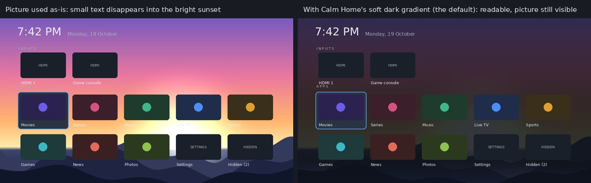

# TV Calm

A tiny, ad-free home screen for Android TV / Google TV, plus a cautious cleanup
toolkit. Python 3.8+ standard library only; runs on Windows, macOS and Linux.

## What you get
- **Calm Home** (`app/`): one screen with a clock, your HDMI inputs and your apps.
  No network, **no permissions** (checked on every build). Most-used apps rise to the
  top. Long-press OK (or Menu) on an app: move to front, hide, App info. Hidden apps
  are always recoverable, and a Settings tile is always present, so you can't lock
  yourself out. Works on Android 5.0 (API 21) and newer.
- **Your own wallpaper** (optional): a JPG/PNG/WebP behind the apps, with a soft dark
  gradient. The launcher measures how bright each part of the picture is and darkens just
  enough to keep every label readable, even on a very bright photo.
- **`tvcalm.py`**: scan, debloat, tune, install, restore, undo, lockdown, build.

## Quick start
1. On the TV: Settings > Device Preferences > About > press **Build** 7 times, then
   Developer options > turn on **USB/network debugging**. Install `adb`
   (Android platform-tools) on your computer, on the same Wi-Fi as the TV.
2. Get the APK, either way:
   - **No SDK:** push this folder to a GitHub repo. The `build-apk` workflow runs all
     tests, builds the APK and uploads it. Download the `calmhome` artifact into `out/`.
   - **Local:** JDK 17 + Android SDK (`ANDROID_HOME`), then `python tvcalm.py build`.
3. `python tvcalm.py scan <tv-ip>`        (read-only: memory hogs, protected apps)
4. `python tvcalm.py debloat <tv-ip>`     (dry run), then again with `--apply`
5. `python tvcalm.py install <tv-ip>`
6. `python tvcalm.py tune <tv-ip> --apply`
7. *(optional)* `python tvcalm.py wallpaper <tv-ip> "C:\path\to\picture.jpg"`
8. `python tvcalm.py lockdown <tv-ip>`    (turns debugging off)

## Wallpaper

- `python tvcalm.py wallpaper <tv-ip> picture.jpg` sets it; `--remove` takes it off.
- `--dim 0..100` (default 40) makes the gradient lighter or darker. A picture that is too
  bright is always darkened to a readable minimum first; `--dim` adds darkness on top.
- Best: a wide 1920x1080 (or larger) JPG under 30 MB. HEIC/AVIF aren't supported.
- No permissions: the picture is copied into Calm Home's own folder on the TV
  (`Android/data/app.calmhome/files`), which is also deleted if you uninstall the app.

## Safety model
- Nothing is uninstalled; apps are only *disabled* (`pm disable-user`).
- Every change is recorded in `~/.tvcalm/` on **your computer** *before* it is made,
  so even a crash mid-change is recoverable. `restore` reverts; `undo` brings the stock
  home back and removes Calm Home.
- Never offered for disabling: the Android framework, Play Services/Store, WebView,
  keyboards, anything that provides a TV input (HDMI/tuner), current role holders
  (dialer, assistant, ...), chipset-vendor services (MediaTek, Qualcomm, Amlogic, ...),
  and anything whose name says setup, Wi-Fi, Bluetooth, USB, settings, permissions, etc.
- After changes the TV is health-checked (boot complete, a home screen resolves, a
  keyboard exists); on failure everything is rolled back automatically.
- Per-package confirmation; there is intentionally no "yes to all".
- No downloads at install time. The APK's SHA-256 is verified.
- Stock-launcher takeover is verified and reverted if Calm Home still isn't default.

## Tests
`python tests/run_all.py` runs everything:
- **Java unit tests** (plain JVM): grid maths swept across 8 widths x 8 densities
  (rows always fit, 16:9 art, no wasted strip), 300 randomized rounds that hammer the
  sort comparator, and the wallpaper maths, including an end-to-end test that builds 11
  kinds of wallpaper (all white, noise, gradients, saturated colours, ...), applies the
  real gradient and checks the text contrast of every pixel. ~220,000 checks. (Deliberately
  breaking the maths makes these tests fail; that was verified.)
- **Python tests** (61): the toolkit against a simulated TV, covering unauthorized and
  offline devices, protection rules, dry runs, auto-rollback, crash recovery, tune/restore
  round trips, checksum refusal, signature conflicts, takeover that works / needs the
  stock launcher disabled / never works, old shells, undo with and without a snapshot,
  lockdown, and every wallpaper case (not installed, bad or oversized picture, small and
  portrait warnings, fallback copy route, total failure, remove). Plus a real APK build that
  asserts zero permissions and a clean output folder.
- **CI** also compiles against Android API 21, 23, 26 and 30 stubs (min-SDK safety).
- **`emulator-smoke` workflow** (run manually from the Actions tab): boots an Android TV
  emulator, installs the APK, presses remote keys, checks for the clock, the Settings
  tile, the options dialog and crashes, sends a test wallpaper and **reads the screenshot's
  pixels** to confirm it really appears (and disappears again), uploads screenshots,
  then runs `undo`.

## Honest limits
- Everything above was verified in a simulated environment. The launcher has **not been
  run on real hardware by its author**. Run the `emulator-smoke` workflow, then try one
  TV with `scan` and dry runs first.
- Protection is conservative, not vendor-aware: it can't know that a given
  `com.vendor.*` service is safe. Memory use and ad/promo hints help you decide.
- The wallpaper is read from the app's folder on shared storage. That works on Android
  by design, but it is exactly what the `emulator-smoke` workflow checks, and it has not
  been seen on a real TV yet. If it doesn't show up, send me the output of the command.
- HDMI tiles launch via the system Live TV app; if a brand disables it, they won't open.
- Artwork comes from each app's banner; apps without one get a centred icon.
- CI builds use a fresh signing key each run, so updating from a CI build asks to
  replace the installed copy (pins and hidden list reset). Local builds keep one key.
- Android TV / Google TV only (not Samsung Tizen, LG webOS or Roku).
