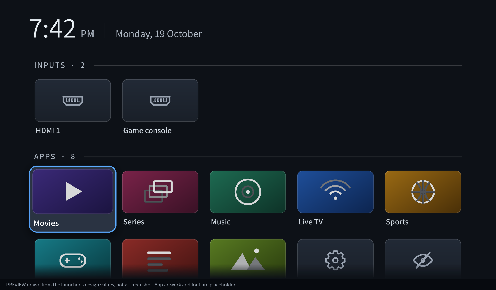
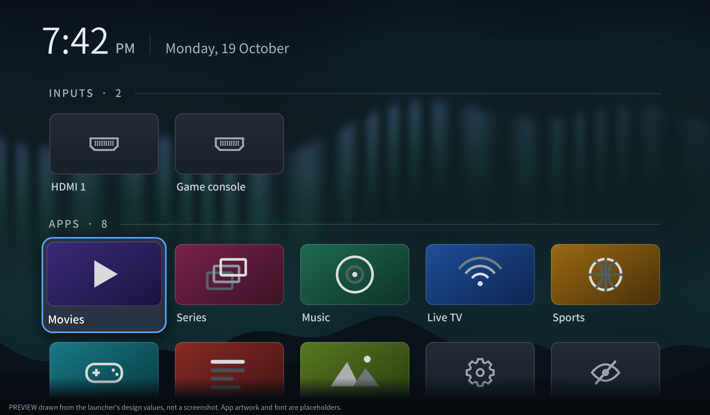

# TV Calm

A tiny, ad-free home screen for Android TV / Google TV, plus a cautious cleanup toolkit.
Python 3.8+ standard library only; runs on Windows, macOS and Linux.

> **Status: tested on an emulator, not on a physical TV.**
> It has been installed, launched, driven with remote keys, given a wallpaper, and undone on an
> Android 14 TV emulator. No physical television has been tested yet. Read
> [What has and hasn't been tested](#what-has-and-hasnt-been-tested) before using it on a TV.

## What you get

- **Calm Home** (`app/`): one screen with a clock, your HDMI inputs and your apps. No network,
  **no permissions** (checked on every build). Most-used apps rise to the top. Long-press OK
  (or Menu) on an app: move to front, hide, App info. Hidden apps are always recoverable, and
  a Settings tile is always present. Targets Android 5.0 (API 21) and newer.
- **A finished look:** rounded cards with soft gradients and hairline edges, drawn HDMI /
  settings / hidden icons, section headers with counts and dividers, a lifted focus state with
  a ring, shadow and brightened label, rows that fade as they scroll away, and dark rounded
  dialogs. Every colour and size lives in one file (`Theme.java`) with contrast tests.
- **Your own wallpaper** (optional): a JPG/PNG/WebP behind the apps with a soft dark gradient.
  The launcher measures how bright each part of the picture is and darkens just enough to keep
  labels readable.
- **`tvcalm.py`**: build, scan, debloat, tune, install, wallpaper, restore, undo, lockdown.

## Quick start

1. On the TV: Settings > Device Preferences > About > press **Build** 7 times, then Developer
   options > turn on **USB/network debugging**. Install `adb` (Android platform-tools) on your
   computer, on the same Wi-Fi as the TV.
2. Get the APK, either way:
   - **No SDK:** push this repository to GitHub. The `build-apk` workflow runs the tests,
     builds the APK and uploads it. Download the `calmhome` artifact into `out/`.
   - **Local:** JDK 17 + Android SDK, then `python tvcalm.py build`.
3. `python tvcalm.py scan <tv-ip>` (read-only: memory use, protected apps)
4. `python tvcalm.py debloat <tv-ip>` (dry run: **a list to review, not a list of safe
   removals**), then `--apply` only for packages you have decided on
5. `python tvcalm.py install <tv-ip>`
6. `python tvcalm.py tune <tv-ip> --apply`
7. *(optional)* `python tvcalm.py wallpaper <tv-ip> "C:\path\to\picture.jpg"`
8. `python tvcalm.py lockdown <tv-ip>` (turns debugging off)

For a first run on a real TV, follow the cautious order in
[docs/TESTING.md](docs/TESTING.md#9-before-you-trust-it-on-a-physical-tv).

## How it looks




> **These are renderings, not screenshots.** `tools/render_preview.py` redraws the screen from
> the app's real design values (colours, sizes, grid maths, icon geometry, wallpaper gradient
> are read from the Java classes), so it stays honest as the design changes. What a real TV
> adds or changes: each app's own banner artwork (placeholders here), the TV's Roboto font
> (Noto Sans here), and Android's own anti-aliasing and shadow rendering. Regenerate with
> `python tools/render_preview.py` (needs a JDK, Pillow and numpy).

## Wallpaper

A very bright picture is the hard case. Left: used as-is. Right: with Calm Home's gradient.


- `python tvcalm.py wallpaper <tv-ip> picture.jpg` sets it; `--remove` takes it off.
- `--dim 0..100` (default 40) makes the gradient lighter or darker. A picture that is too
  bright is always darkened to a readable minimum first; `--dim` adds darkness on top.
- Best: a wide 1920x1080 (or larger) JPG under 30 MB. HEIC/AVIF aren't supported.
- No permissions: the picture goes into Calm Home's own folder on the TV
  (`Android/data/app.calmhome/files`), which is deleted if you uninstall the app.

## Safety model

- Nothing is uninstalled; apps are only *disabled* (`pm disable-user`).
- Every change is recorded in `~/.tvcalm/` on **your computer** *before* it is made, so even a
  crash mid-change is recoverable. `restore` reverts; `undo` brings the stock home back and
  removes Calm Home.
- Never offered for disabling: the Android framework, Play Services/Store, WebView, keyboards,
  anything that provides a TV input (HDMI/tuner), current role holders (dialer, assistant, ...),
  chipset-vendor services, and anything whose name says setup, Wi-Fi, Bluetooth, USB, settings,
  permissions, etc. This protection is conservative, **not vendor-aware**: it cannot know that a
  given vendor package is safe to remove.
- After changes the TV is health-checked (boot complete, a home screen resolves, a keyboard
  exists); on failure everything is rolled back automatically.
- Per-package confirmation; there is intentionally no "yes to all".
- No downloads at install time. The APK's SHA-256 is verified.
- Stock-launcher takeover is verified and reverted if Calm Home still isn't the default.

## What has and hasn't been tested

Full detail: [docs/TESTING.md](docs/TESTING.md) and
[docs/TEST-REPORT-2026-10-20.md](docs/TEST-REPORT-2026-10-20.md).

| Area | Status |
| --- | --- |
| Java unit tests (layout, sorting, wallpaper maths, design tokens, icon geometry) | **Passed**: 220,263 checks in the Windows 11 session; 220,516 now on Linux (design-token and icon tests were added since) |
| Python tests against a simulated TV (91 tests, including the smoke script run against a simulated device) | **Passed on Linux**, in two output modes, 0 skipped. **Skipped on native Windows in the 20 Oct 2026 session**; since made portable but **not yet re-run on Windows** |
| APK build, signing, zero permissions | **Passed** (Windows 11 and Linux) |
| Android 14 TV emulator: install, takeover, scan, dry run, tune + restore, launch, wallpaper (screen pixels), undo, recovery | **Passed** (Windows 11 + Git Bash, 20 Oct 2026, with the scripts as they were then) |
| Emulator: options dialog from the Menu key | **Not exercised** in that session. The smoke script now looks for an app tile; its logic passed against a simulated device (Linux), but it has **not been re-run on a real emulator** |
| Emulator: applying debloat | **Not exercised** (dry run only). Optional `SMOKE_DEBLOAT=1` step added; passed against a simulated device only |
| Updated smoke script on a real emulator / in Git Bash | **Not yet run** (only against a simulated device on Linux) |
| The polished UI (new header, tiles, icons, dialogs) on a real screen | **Not yet seen on any device.** It compiles for Android 5-11 and its design values are unit-tested; the pictures above are renderings |
| **Any physical TV (including TCL)** | **Not tested** |
| Performance (speed, memory savings) | **Not measured**; no performance claim is made |

Tested environment: Windows 11, Python 3.12.10, Git Bash, Android SDK local install, Android 14
(API 34) `google AOSP TV on x86` emulator.

### Run the tests yourself

```bash
python tests/run_all.py            # unit + simulated-TV tests; READ the summary for skips
python tests/run_all.py --strict   # fail if anything was skipped
python tvcalm.py build             # build and verify the APK
bash tests/emulator_smoke.sh       # needs a booted Android TV emulator (Git Bash on Windows)
```

An exit code of 0 is not enough: `run_all.py` prints which parts ran, passed or were skipped.
Skipped means **not verified**.

## Known limitations

- Emulator success is not physical-TV success. Vendor launchers, firmware, remotes, HDMI
  inputs and 4K behaviour can differ.
- HDMI tiles launch via the system Live TV app; if a brand disables it, they won't open.
- The wallpaper is read from the app's folder on shared storage; it works on the Android 14
  emulator but has not been seen on a real TV.
- Artwork comes from each app's banner; apps without one get a centred icon.
- CI builds use a fresh signing key each run, so updating from a CI build asks to replace the
  installed copy (pins and hidden list reset). Local builds keep one key.
- Android TV / Google TV only (not Samsung Tizen, LG webOS or Roku).

## Documentation

- [docs/TESTING.md](docs/TESTING.md): what each test proves, commands, expected output,
  Windows/Git Bash troubleshooting, recovery checks, first-run plan for a real TV
- [docs/DEVELOPING.md](docs/DEVELOPING.md): layout, setup, building, how the simulated TV works,
  safety rules to preserve
- [docs/TEST-REPORT-2026-10-20.md](docs/TEST-REPORT-2026-10-20.md): the emulator session record,
  findings and what changed afterwards

Optional GitHub workflows (Actions tab > Run workflow): `emulator-smoke` (boots a TV emulator
and checks the app on-screen) and `windows-tests` (runs the test suite on Windows).
